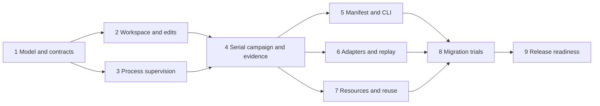

# Bootstrap Heni for trustworthy mutation testing and Hackage release

This MasterPlan coordinates nine child ExecPlans. The registry owns their status; each child owns its implementation milestones. Update coordination and affected ADRs when interfaces or acceptance change. The initiative is linked to the intention in frontmatter. Creating these plans does not implement the library or authorize publication.

## Vision & Scope

Heni will let a maintainer describe a deliberate source or fixture fault, prove that the unchanged tests pass, and require a specific test or diagnostic to catch the fault in a disposable workspace. A short Haskell definition or JSON manifest replaces repeated backup, patch, subprocess, restoration, and evidence code. The library returns structured results; the `heni` CLI uses the same execution and classification logic. Both work in ordinary Cabal projects on Linux and macOS, with released dependencies and no mandatory Nix, Mori, OKF, Git repository, database, or broker. Only the optional patch integration requires Git.

The baseline is [docs/initial-spec.md](../initial-spec.md), including all nine case outcomes, controls, replay, explicit crash probes, staged execution, versioned reports, and release criteria. A baseline is an unchanged build/test run under the candidate's configuration. A control is an explicitly unchanged case that must pass. A witness is concrete evidence of the expected failure, such as a named assertion result or a specific diagnostic combined with the declared exit code. Neither arbitrary command failure nor timeout counts as a semantic detection.

Read [docs/research/index.md](../research/index.md) first. [RES-1](../research/mutation-testing-survey.md) establishes four extraction patterns and the limits of the source survey. [RES-2](../research/ecosystem-mutation-testing-design.md) compares primary documentation for cargo-mutants, StrykerJS/.NET, PIT, and mutmut, then records proposed adoption decisions. This is researched planning, not a benchmark result or a claim that all future scripts are supported. Success requires executable examples, adversarial classification checks, migration trials that measure orchestration reduction, and portable release artifacts.

The first release includes curated patches, exact-count UTF-8 replacement, structured Haskell custom edits and expectations, generic commands, named-test evidence, optional Tasty/Hspec integrations, bounded processes, reports, and resource-aware workers. The two primary packages remain `heni` and `heni-cli`; optional framework reporter packages `heni-tasty` and `heni-hspec` keep their dependencies out of the core. Their names are provisional until registry checks. Do not export a framework's types from `Test.Heni`.

Automatic AST operators, GHC plugins, distributed execution, coverage-driven selection, persistent cross-run verdict caches, automatic equivalence declarations, Windows support claims, and fleet-wide script replacement are deliberately later work. Cross-repository migrations are not part of bootstrapping Heni; this initiative supplies representative local conformance fixtures and migration recipes. Consumer hooks can express additional needs, but unsupported patterns must be recorded rather than hidden behind a claim of universality. Hackage uploads, including candidate uploads, are separate release actions after a concrete readiness bundle exists.

## Decomposition Strategy

The split follows independently observable responsibilities. EP-1 provides a compiling model and a pure classifier with adversarial evidence fixtures, rather than freezing an untested DSL. EP-2 owns source isolation and edits; EP-3 owns operating-system processes. EP-4 joins them into the first real baseline-to-report cycle before user-facing or framework-specific variants grow. EP-5 makes that cycle available to scripts. EP-6 supplies stronger test evidence, replay, and crash-probe execution. EP-7 adds resource lifetimes and safe reuse after serial execution is trustworthy. EP-8 measures replacement value across the surveyed patterns. EP-9 proves distribution and prepares publication materials.

A single large runner plan would obscure process and filesystem failure obligations. Conversely, separate plans per edit type or per CLI verb would duplicate ownership. Framework integrations and replay share one evidence contract; resource acquisition and worker reuse share lifetime and scheduling invariants. These concerns stay together. EP-2 and EP-3 can proceed independently after EP-1; EP-5, EP-6, and EP-7 can proceed after EP-4, subject to the ownership rules below. No delegated work is required by this plan.

No local `docs/adr/` corpus existed at creation, and `mori.dhall` declares a research bundle but no ADR bundle. Two relevant cross-repository ADRs were located, resolved, and inspected: [library-owned infrastructure with consumer-owned effects](mori://shinzui/mori-app/okf/adrs/concepts/ADR-1), and [CLI commands wrapping supported owner APIs](mori://shinzui/keiro/okf/adrs/concepts/ADR-28). Apply their boundary lessons, not their service frameworks or authorization machinery. EP-1 records Heni's own architecture decisions after the executable model; later owners record isolation, supervision, evidence, scheduling, and compatibility decisions as their behavior is proved. Follow `agents/skills/exec-plan/ADR.md` at each write.

Apply [core standards](mori://shinzui/haskell-jitsurei/docs/core-standards), [record patterns](mori://shinzui/haskell-jitsurei/docs/core-record-patterns), and [prelude guidance](mori://shinzui/haskell-jitsurei/docs/core-custom-prelude). Use GHC2024 and the GHC 9.12-or-newer policy, strict records, explicit deriving, postpositive qualified imports, and a small internal prelude. Verify actual GHC releases and dependencies before selecting tested bounds. Preserve the public import closure from orphan label instances: use constructor matching and explicit combinators there, documenting this scoped adaptation of the lens-heavy application pattern. CLI internals may use local label imports. No copied application effect stack or broad public prelude is required.

## Exec-Plan Registry

| # | Title | Path | Hard Deps | Soft Deps | Status |
| --- | --- | --- | --- | --- | --- |
| 1 | Public model and executable API contracts | [docs/plans/1-establish-the-public-model-and-executable-api-contracts.md](../plans/1-establish-the-public-model-and-executable-api-contracts.md) | None | None | Complete |
| 2 | Isolated snapshots and checked mutations | [docs/plans/2-implement-isolated-snapshots-and-checked-mutations.md](../plans/2-implement-isolated-snapshots-and-checked-mutations.md) | EP-1 | None | Complete |
| 3 | Bounded processes and cancellation | [docs/plans/3-supervise-bounded-processes-and-cancellation.md](../plans/3-supervise-bounded-processes-and-cancellation.md) | EP-1 | EP-2 | Complete |
| 4 | Baseline-to-report campaigns | [docs/plans/4-run-baseline-to-report-mutation-campaigns.md](../plans/4-run-baseline-to-report-mutation-campaigns.md) | EP-2, EP-3 | None | Complete |
| 5 | Strict manifests and shared CLI | [docs/plans/5-expose-strict-manifests-and-the-shared-cli.md](../plans/5-expose-strict-manifests-and-the-shared-cli.md) | EP-4 | None | Complete |
| 6 | Named-test adapters, replay, crash evidence | [docs/plans/6-add-named-test-adapters-replay-and-crash-evidence.md](../plans/6-add-named-test-adapters-replay-and-crash-evidence.md) | EP-4 | EP-5 | In Progress |
| 7 | Resource-aware workers and verified reuse | [docs/plans/7-add-resource-aware-workers-and-verified-reuse.md](../plans/7-add-resource-aware-workers-and-verified-reuse.md) | EP-4 | EP-5 | Not Started |
| 8 | Representative migration and usability proof | [docs/plans/8-prove-representative-script-migration-and-usability.md](../plans/8-prove-representative-script-migration-and-usability.md) | EP-5, EP-6, EP-7 | None | Not Started |
| 9 | Portable packages and Hackage preparation | [docs/plans/9-validate-portable-packages-and-prepare-the-hackage-release.md](../plans/9-validate-portable-packages-and-prepare-the-hackage-release.md) | EP-8 | None | Not Started |

All hard dependencies name whole children and require Complete status. Status values are Not Started, In Progress, Complete, and Cancelled. Soft dependencies share useful context without blocking work.

## Dependency Graph

EP-2 and EP-3 need EP-1's validated model and test targets. EP-4 cannot assert a real detection until both source isolation and bounded process execution are accepted. EP-5, EP-6, and EP-7 consume its real runner and report writer, rather than developing incompatible substitute runners. EP-8 requires all three so migration trials exercise the final public paths, richer evidence, and shared-resource behavior. EP-9 requires the demonstrated API and examples so it packages the accepted product.

Default execution is registry order. Parallel execution is possible only on the independent branches above, with shared-file edits coordinated through their owner. EP-4 M1 is the early integration proof: one replacement, one baseline, one explicit diagnostic failure, one survivor, and one useful report from the actual library. This gate happens before expanding adapters or workers. EP-6 and EP-7 are individually testable through the library without EP-5; EP-8 reconciles all manifest and CLI representations before accepting a migration.

## Integration Points

EP-1 owns `heni.cabal`, `cabal.project`, the initial CI job, `src/Test/Heni.hs`, and the stable model in `src/Test/Heni/{Case,Command,Expectation,Result,Internal/Model}.hs`. It defines `CaseId`, validated relative targets and budgets, `StageEvidence`, `SelectionEvidence`, `CaseResult`, `RunResult`, and the single pure `classifyCase`/`summarizeRun` path. Later children extend their owned implementation modules and add focused tests; incompatible model changes must update the owner tests and affected plans together. Smart constructors keep invalid portable definitions out of execution. Haskell hooks are separate executable values rather than pretend-serializable functions.

EP-2 owns `Workspace.hs`, `Edit.hs`, and patch internals. Its immutable `SourceSnapshot`, scoped mutable `Workspace`, checked edit evidence, and restoration verification feed EP-4 and EP-7. Start with fresh copies. Git patch application is confined to a scratch tree; custom IO hooks are trusted code using a capability API, not an OS sandbox. EP-3 owns `Process.hs` and platform internals. Its structured exit/signal/timeout result and bounded log artifacts are consumed by every stage, including setup, teardown, and replay. EP-2's patch subprocess uses that supervisor when EP-3 becomes available; its standalone tests initially use a bounded test helper. EP-4 verifies this replacement so production never keeps an unsupervised subprocess path.

EP-4 owns `Runner.hs`, `Report.hs`, event types, the journal and atomic report writer, and report-schema v1. It defines the authoritative selected-case ledger, cancellation finalization, log references, and run-level failures. EP-5 owns manifest-schema v1, `Manifest.hs`, `heni-cli/`, human rendering, and exit mapping from library run status. It may not recompute verdicts. EP-6 owns `Adapter.hs`, `Replay.hs`, `Crash.hs`, protocol-schema v1, and optional reporter packages under `adapters/`. Their events become core `StageEvidence`; they never choose a verdict or silently parse arbitrary terminal output as structured evidence.

EP-7 owns `Resource.hs` and `Scheduler.hs`, including scoped acquire/use/release, deterministic case scheduling, resource claims, baseline identity, and reuse policy. Its changes to `Runner.hs` must preserve EP-4's serial behavior and exactly-once final case accounting. A baseline key includes snapshot, source-selection policy, effective commands/configuration, selector, adapter version, environment contract, and resource identity. Secret values must not be exposed in portable reports or weak hashes. A changed resource epoch or unrepresentable external state disables reuse.

EP-1 establishes ordinary Cabal validation; each owner adds its tests to CI. EP-9 owns the final supported OS/GHC matrix, package metadata, source-archive checks, and release evidence. Keep `heni.cabal` at the repository root to match the existing root-package scaffold; `heni-cli/` and `adapters/` are added Cabal packages. Optional Nix wiring belongs in `flake.module.nix`, following the installed scaffold contract; do not casually repin generated `flake.nix`/`nix/*.nix` files.

EP-4 owns `examples/minimal/` and the library smoke example; EP-5 adds their manifests and owns `docs/cli.md` and `docs/troubleshooting.md`. EP-8 extends troubleshooting from migration evidence, and EP-9 performs the final documentation/package audit without changing those semantic owners. EP-1 owns `docs/design/api-contract.md` and `docs/design/classification.md`; the implementation owner of each remaining `docs/design/` document maintains it when later consumers expose a correction.

EP-8 owns `examples/migrations/`, `docs/migration-guide.md`, and the parity/effort record. Preserve the original case expectations and document any stronger rejection of a legacy false positive. Dependencies on surveyed repositories appear as canonical Mori URIs with project-relative paths when file-level URI coverage is pending. Core CI fixtures must not need those checkouts or their services.

Requirement coverage follows the initial spec: sections 1–4 are established by EP-1 and packaged by EP-9; sections 5–6 by EP-2 and EP-4; sections 7–8 by EP-1, EP-3, EP-6, and EP-7; section 9 by EP-5; section 10 by EP-4, EP-5, and EP-7; section 11 by adversarial checks in every owner and final EP-9 archive gates; section 12 by EP-8. This mapping preserves the original acceptance obligations when work is reordered.

Cross-plan ADR topics are package/public API boundaries (EP-1), snapshot and edit confinement (EP-2), process ownership and platform limits (EP-3), classification/report trust and recovery (EP-4), wire compatibility (EP-5), adapter/replay evidence identity (EP-6), resource and reuse semantics (EP-7), migration exclusions (EP-8), and supported release policy (EP-9). No API is considered stable for publication until EP-8's consumer trials and EP-9's package gates pass.

## Progress

EP-1 completed on 2026-10-24 with ordinary Cabal build, 28 adversarial classification scenarios, API construction/label fixtures and Haddock. EP-2 completed with isolated snapshot/edit/recovery tests. EP-3 completed with bounded process-group and log/witness tests. EP-4 completed: the real standalone Cabal baseline-to-report gate passed, including caught/survived/unexpected-build-failure, recovery and cancellation. EP-5 completed with strict schemas/decoder, executable CLI parity and SIGINT finalization. EP-6 is In Progress. Later children await their hard prerequisites. RES-1 and RES-2 supply the use cases and ecosystem evidence. The remaining integration gates are the real serial cycle in EP-4, the combined CLI/library migration suite in EP-8, and extracted-source publication readiness in EP-9. No compiler compatibility, runtime performance, or migration savings have yet been measured.

## Surprises & Discoveries

The public model is executable and conservative: malformed or truncated evidence is infrastructure failure, not detection. Local ADRs now record the framework-neutral core and evidence-owned classifier. Initial compiler validation is macOS/GHC 9.12.4; the CI matrix has not yet run remotely. The first real integration gate is accepted. Reports now preserve explicit redaction, exact byte witnesses, baseline/patch/candidate artifacts and a sequenced selected ledger. A shared token decoder is required because ordinary JSON map decoding loses duplicate keys.

## Decision Log

2026-10-24: Keep one classifier and a generic command runner at the center, with framework reporters outside the core. This follows the spec and avoids carrying a first consumer's infrastructure into the public API.

2026-10-24: Establish pure classification fixtures first and require the real serial producer/consumer path before adapters or concurrency. This resolves uncertain interfaces early without freezing speculative API signatures.

2026-10-24: Separate migration proof from fleet migration, and release preparation from uploading. The bootstrap must demonstrate value and installability without silently expanding into edits across consumer repositories or publication.

2026-10-24: Adopt explicit source/test/configuration identities for reuse and keep timeouts unresolved. Ecosystem research supplies useful techniques, but its scoring and cache assumptions do not replace Heni's more precise evidence contract.

## Outcomes & Retrospective

To be filled during implementation. At completion, distill durable lessons into local ADRs, triage initiative-level friction, and report supported and unsupported migration patterns with measured evidence.
